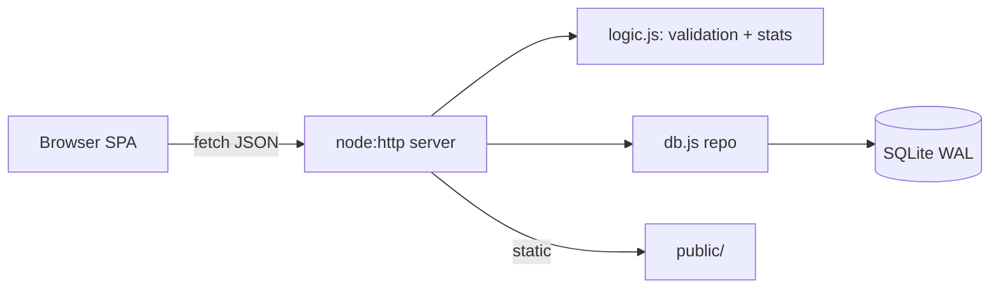

# Architecture, API and database

Flow: user action → `app.js` → `/api/*` → validation (`logic.js`) → prepared statements (`db.js`) → JSON → DOM re-render. Errors: `HttpError` → JSON `{error, details}`; unexpected → 500 with no internals leaked.
**Decisions:** one process, one SQLite file (simple, cheap, persistent on a volume); no framework/build step so there is nothing to break at deploy time. Single-user by design; password is optional Basic auth (use behind HTTPS).
**Security:** parameterized SQL, DOM built with `textContent` (no `innerHTML`), CSP `default-src 'self'`, `X-Frame-Options: DENY`, timing-safe password compare, static path-traversal guard, CSV formula neutralization.

## API
| Method & path | Description |
|---|---|
| GET `/api/health` | `{ok:true}` (unauthenticated) |
| GET/POST `/api/decisions` | list / create (201) |
| GET/PUT/DELETE `/api/decisions/:id` | read / replace / delete (204) |
| POST `/api/decisions/:id/review` | `{outcome: hit\|partial\|miss, outcomeNote}` |
| POST `/api/decisions/:id/reopen` | back to open |
| GET `/api/stats` | calibration stats |
| GET `/api/export[?format=csv]` | download |
Decision body: `title, context, choice, prediction, confidence(50–99 int), decidedAt, reviewOn (YYYY-MM-DD, ≥ decidedAt), tags[]`. Errors: 400 bad JSON/id, 401, 404, 405, 413, 422 `{details:{field:msg}}`.

## Database (`decisions`, migrations via `PRAGMA user_version`)
`id PK AUTOINCREMENT, title (1–200), context, choice, prediction, confidence CHECK 50–99, tags JSON text, decided_at, review_on, status CHECK open|reviewed, outcome CHECK hit|partial|miss, outcome_note, reviewed_at, created_at, updated_at`; index `(status, review_on)`.

## Design system
Warm paper palette with deep green brand and amber accent, Georgia headings + system sans body, 12 px radii, CSS variables with automatic dark mode, visible focus rings, ≥ 40 px controls. Components: cards, stat tiles, pills, filters, form, dialog, toasts, table, SVG chart; empty / loading / error states each implemented.
